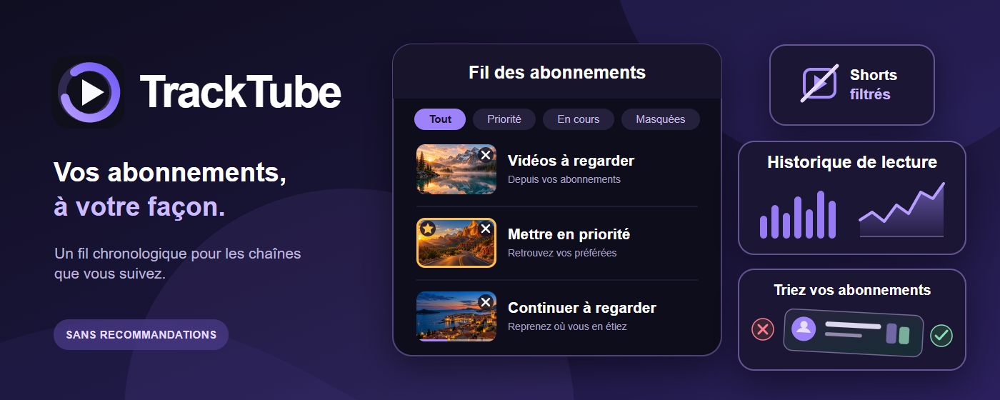
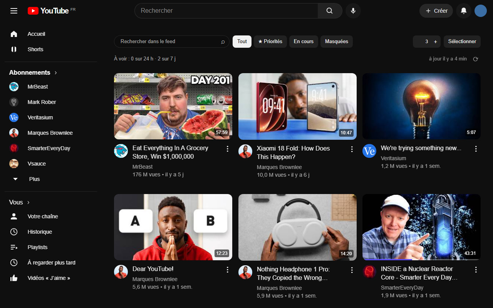
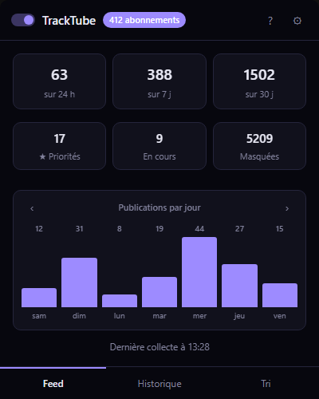
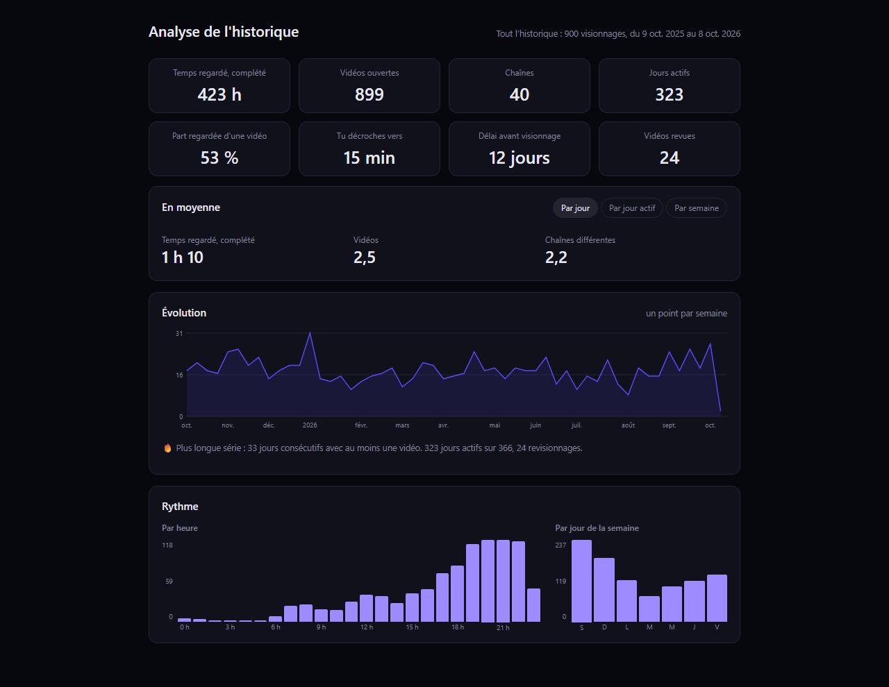
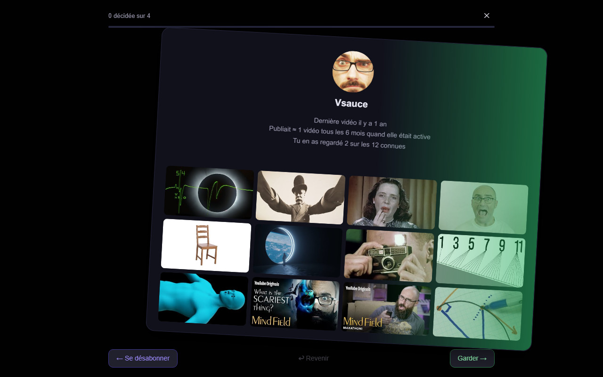

# TrackTube

[English](README.md) · **Français**



**Tes abonnements YouTube, dans l'ordre, avec filtrage des Shorts.**

TrackTube remplace la page Abonnements de YouTube par un fil chronologique
collecté chaîne par chaîne. Il retire les recommandations, filtre les Shorts
identifiés et permet d'actualiser les publications récentes pour rattraper des
manques. YouTube peut retarder ou cacher des publications et la classification
des Shorts ; la couverture n'est donc pas absolue. Tout reste dans ton navigateur.

---

## Pourquoi

La page Abonnements ouvre sur deux sections qui prennent tout l'écran : un
carrousel de ce que YouTube juge le plus pertinent, et un carrousel de Shorts.
Les deux sont de la recommandation. La liste chronologique des chaînes
auxquelles tu t'es réellement abonné commence en dessous, une fois que tu les as
dépassées.

Et cette liste n'est pas toujours complète. Une vidéo d'une chaîne que tu suis
n'apparaît parfois jamais, et apparaît parfois plusieurs jours en retard.

Au Made on YouTube de septembre 2026, YouTube a annoncé les
[Custom Feeds](https://techcrunch.com/2026/09/23/youtube-will-let-you-build-your-own-algorithm-with-ai/) :
tu décris avec tes mots les vidéos que tu voudrais voir recommandées, Gemini
construit le feed, et il reçoit un onglet à lui à côté d'Accueil. C'est la
tendance, et elle n'est pas que du côté de YouTube : en dehors de quelques
puristes, plus grand monde n'ouvre l'onglet Abonnements.

C'était pourtant tout l'intérêt. On s'abonnait aux gens qu'on voulait soutenir,
et rafraîchir la page disait lesquels d'entre eux avaient posté quelque chose.

TrackTube reconstruit cette liste depuis le flux public de chaque chaîne, une
chaîne après l'autre, et l'affiche à la place de celle de YouTube. Rien n'est
filtré sans que tu l'aies demandé.

---

## Ce que tu obtiens

### Un feed qui se vide



Masque une vidéo et la carte quitte la grille au moment du clic, donc tu peux
masquer à la chaîne, et un mode sélection le fait par lots. Le masquage de
YouTube, lui, grise la vignette et la laisse où elle était.

Une vidéo masquée y est aussi chargée et dessinée quand même, donc la page
ralentit à mesure que les vidéos masquées s'accumulent. Ici le masquage est
filtré à l'intérieur de l'index de la base : une vidéo masquée n'est jamais lue,
jamais désérialisée, jamais dessinée, donc le coût reste le même que tu en aies
masqué dix ou quarante mille.

C'est l'usage autour duquel TrackTube est construit. Le feed est une liste de
vidéos à voir, que tu vides : dès que tu sais que tu ne regarderas pas quelque
chose, ou que tu l'as déjà vu, ça part.

**Les étoiles** servent dans l'autre sens. Sur un lot de vingt nouveautés,
étoile les deux que tu comptes vraiment regarder pour qu'elles ne se perdent pas
dans le reste, et elles ont en plus une vue à elles.

**En cours** dit quelles vidéos tu as déjà commencées et te laisse en reprendre
une là où tu l'avais laissée, depuis sa propre vue. Et si tu veux que la liste
se vide d'elle même, tu peux activer le masquage automatique d'une vidéo une
fois que tu l'as vue, la part de la vidéo qui compte comme vue étant à toi de
régler.

### Une popup qui dit où en sont les choses



Un interrupteur désactive et réactive la reprise de la page Abonnements, donc la
page de YouTube revient intacte dès que tu la veux.

En dessous, les chiffres qui méritent un coup d'œil : ce qui est arrivé dans le
dernier jour, la dernière semaine et le dernier mois, ce qui est en priorité, ce
qui est en cours, combien est masqué, et quand la dernière collecte a tourné.
Puis les deux portes vers le reste de l'extension, qui sont les deux sections
suivantes ici : l'analyse de ce que tu regardes, et le tri de tes abonnements
carte par carte.

### Une analyse de ce que tu regardes vraiment



Le temps passé sur n'importe quelle plage, par chaîne et par jour. Les chaînes
que tu ne manques jamais, et la longueur de ta série sur chacune. Le délai entre
une publication et le moment où tu l'as ouverte. L'endroit où tu arrêtes de
regarder. Ce que tu reviens voir, et combien de fois. Les sujets qui reviennent
dans les titres, et une classification plus large par thème. L'heure de la
journée et le jour de la semaine où tu regardes. Tes séances, c'est à dire les
visionnages regroupés d'une traite, et leur durée. La fréquence de publication
d'une chaîne. Et un journal jour par jour qui montre les lignes d'une journée
exactement comme elles sont stockées, ce qui en fait le premier endroit où
regarder quand un chiffre ailleurs paraît faux.

Trois sources l'alimentent, et elle dit toujours laquelle. Un export Google
Takeout couvre les années d'avant toute installation. La page d'historique de
YouTube peut être lue pour les années qu'un export n'atteint pas. Et si tu
actives le relevé, l'extension mesure tes visionnages elle même, **plus
finement que l'historique de YouTube** : YouTube enregistre que tu as ouvert une
vidéo, l'extension enregistre quand, pendant combien de temps, et jusqu'où tu
es allé.

Chaque chiffre dit sur quoi il repose. Un total calculé sur 590 visionnages
datés sur 876 le dit à l'écran ; un chiffre qui ne serait qu'une supposition
affiche un tiret à la place.

Trois petits jeux sont construits sur les mêmes données :

- **La rétrospective** transforme une année, ou n'importe quelle plage que tu
  choisis, en six cartes plein écran : les heures passées, le podium de tes
  chaînes par nombre de vidéos et par temps passé, ton heure de pointe et ton
  jour record, les mots qui reviennent dans les titres, et ta plus longue série
  ininterrompue sur une seule chaîne. Chaque carte s'exporte en image.
- **Le duel** met deux de tes chaînes côte à côte et te demande de parier sur
  celle que tu as le plus regardée, avant que les chiffres apparaissent. Tu
  crois connaître ta propre consommation ; se tromper deux fois sur trois en dit
  plus qu'un classement bien rangé.
- **Le tournoi** est un arbre à élimination directe entre tes chaînes où aucun
  chiffre n'est montré pendant les duels, donc tu votes pour la chaîne que tu
  garderais et non pour celle que tu as le plus regardée. Les deux classements ne
  coïncident pas, et c'est tout l'intérêt.

### Un tri de tes abonnements, carte par carte



Le geste est celui des applications de rencontre, et c'est volontaire : une
chaîne par carte, à droite pour garder, à gauche pour se désabonner, et rien à
lire avant de décider. Chaque carte porte les dernières vidéos de la chaîne, la
fréquence à laquelle elle publie, la date de sa dernière publication et la part
que tu en as réellement regardée. Les chaînes qui ont cessé de publier passent
en premier.

Une liste d'abonnements grossit pendant des années et personne ne la taille
jamais. La reprendre de temps en temps vaut la demi heure, et ce n'est pas que
du rangement : une bonne moitié des cartes sont des chaînes auxquelles tu t'es
abonné il y a huit ans et que tu avais oubliées, ce qui se révèle être le
meilleur moment.

Se désabonner désabonne pour de vrai, alors une décision ne part que cinq cartes
plus tard : assez loin pour changer d'avis, assez près pour que rien n'attende
la fin.

## Installation

Pas d'étape de compilation, pas de bundler, aucune dépendance à installer. Le
dossier est l'extension.

1. Télécharge ou clone ce dépôt.
2. Ouvre `chrome://extensions` et active le **mode développeur**.
3. Clique sur **Charger l'extension non empaquetée** et choisis le dossier.
4. La page de bienvenue s'ouvre. Importe tes abonnements depuis celle ci, dans un
   onglet où tu es déjà connecté à YouTube.

Chrome 111 ou plus récent, Manifest V3. Fonctionne aussi sur les navigateurs
basés sur Chromium comme Edge, Brave et Opera GX.

**Laisse le dossier où il est.** Pour une extension non empaquetée, Chrome
dérive l'identifiant de l'extension du chemin absolu du dossier, et la base de
données est rangée sous cet identifiant. Renommer ou déplacer le dossier donne un
autre identifiant et une base vide. Exporte une sauvegarde depuis la popup avant
de déplacer quoi que ce soit.

## Tes données

Rien ne quitte ton navigateur. Il n'y a pas de serveur, pas de compte, pas de
télémétrie, et aucune analyse d'usage d'aucune sorte.

- Tes abonnements, les vidéos collectées, ce que tu as masqué, ce que tu as mis
  en priorité et ce que tu as regardé vivent dans l'IndexedDB de ce navigateur.
- L'extension demande à YouTube les flux publics dont elle a besoin, et se sert
  de la session YouTube déjà ouverte dans ton onglet pour ce qui l'exige : lire
  ta liste d'abonnements, et se désabonner quand tu le demandes.
- Elle ne demande jamais de mot de passe ni de clé d'API, et ne détient aucun
  identifiant.
- La sauvegarde est un fichier que tu gardes.

Permissions demandées : `storage`, `unlimitedStorage`, `alarms`,
`declarativeNetRequestWithHostAccess`, et l'accès à `https://www.youtube.com/*`.
Rien d'autre. La quatrième existe pour une seule règle : les requêtes que
l'extension envoie elle même à l'API interne de YouTube portent l'origine de
YouTube au lieu de celle de l'extension, parce que YouTube les refuse sinon. Elle
ne touche aucune autre requête et n'ajoute aucun avertissement, puisqu'elle n'agit
que là où l'accès à YouTube s'applique déjà. Voir la
[notice de confidentialité](privacy.html), accessible aussi depuis le panneau
d'aide de la popup.

Le relevé de ce que tu regardes est **désactivé jusqu'à ce que tu l'actives**. Le
désactiver ensuite n'efface pas ce qui a déjà été enregistré ; la page d'analyse
a un bouton pour cela.

Un seul compte YouTube par profil de navigateur. La base se rattache au premier
compte qu'elle voit et refuse les écritures venues d'un autre, pour que deux
comptes ne se retrouvent pas mêlés dans les mêmes index. Utilise un profil de
navigateur distinct pour un second compte.

## Ce qui n'est pas promis

- **Un Short peut apparaître brièvement.** Les Shorts sont exclus à l'aide des
  listes de YouTube elles mêmes et des métadonnées du lecteur, et une exclusion
  confirmée est définitive. Mais une vidéo publiée il y a quelques minutes peut
  n'être pas encore classée, et une requête qui échoue n'exclut rien plutôt que
  de deviner. Rien n'est jamais classé d'après sa durée.
- **La collecte automatique est superficielle.** Elle lit le flux récent de
  chaque chaîne, à intervalle régulier. La lecture profonde, qui parcourt les
  onglets Vidéos et En direct de chaque chaîne active sur les sept derniers
  jours, se fait de deux façons : le bouton **Rafraîchir** traite toute la
  liste d'un coup, et tant que la page Abonnements est ouverte quelques chaînes
  sont vérifiées toutes les deux minutes, si bien que la liste défile d'elle
  même. Dans les deux cas, une couverture partielle est signalée quand une
  chaîne n'a pas pu être lue. Le passage en arrière plan se désactive dans les
  réglages.
- **Trois sources alimentent la liste, et seules les chaînes suivies y entrent.**
  Le flux propre à chaque chaîne, la lecture profonde ci dessus, et la page
  Abonnements de YouTube, la seule qui voie une publication au moment où
  YouTube la voit. Une carte venant d'une chaîne que vous ne suivez pas est
  refusée à la collecte puis de nouveau au dessin de la grille, parce que cette
  page mélange des recommandations.
- **Le diagnostic inverse est une comparaison, pas un certificat.** Il dit ce
  que la page de YouTube a montré et que la base ne contient pas. Il ne peut pas
  prouver que l'un des deux côtés est complet.
- **Les aperçus au survol s'arrêtent vers une minute.** C'est la limite de
  YouTube, pas la nôtre, et c'est une durée et non un poids : aucun format plus
  léger ne la contourne. Le rail ombre dès la première image la part qu'il ne
  peut pas atteindre.

Les [limites connues](docs/LIMITES.md) entrent dans le détail.

## Développement

Des modules ES ordinaires, chargés par le navigateur. Pas de compilation, pas de
bundler, pas de TypeScript, pas de `node_modules`. Lis d'abord
[CONTRIBUTING.md](CONTRIBUTING.md), puis [CLAUDE.md](CLAUDE.md) pour savoir
pourquoi le code a cette forme : il consigne les décisions prises après un bug,
c'est à dire la part que la lecture des fichiers ne donne pas.

Lis et écris toujours les fichiers source en UTF-8 explicite.

### Lancer les vérifications

Les suites sont des pages HTML que tu ouvres dans un navigateur. Sers le
dossier :

```bash
python tools/serve-ranges.py 8731
```

Ouvre ensuite `test/index.html` pour la suite de régression,
`test/modules.html` pour vérifier que chaque module s'importe encore, et
`test/coverage.html` pour les chemins de collecte. **Un port différent par
page** : les bancs partagent une IndexedDB avec tout ce qui est servi depuis la
même origine, et `?cb=N` ne vide pas le cache des modules ES.

Avec Node et Playwright, les mêmes bancs tournent sans fenêtre :

```bash
node tools/test.mjs
```

Renseigne `TRACKTUBE_PLAYWRIGHT_PATH` et `TRACKTUBE_BROWSER_PATH` s'ils viennent
d'en dehors du projet. `node tools/diagnose-videos.mjs ID_VIDEO` inspecte les
métadonnées publiques d'une vidéo sans cookies.

`python tools/shoot.py --lang fr feed history triage popup` reconstruit les
captures de ce README en pilotant un Chrome sans fenêtre sur les bancs. Il a
besoin du réseau la première fois : les captures du feed et du tri utilisent de
vraies vidéos lues dans les flux publics
de YouTube, et il met les avatars des chaînes en cache localement pour qu'une
capture ne leur course pas après.

Construis un candidat de distribution avec `python tools/package.py`. L'archive
ne contient que les fichiers d'exécution.

## Licence

[MIT](LICENSE) © Oihan Barreneche
