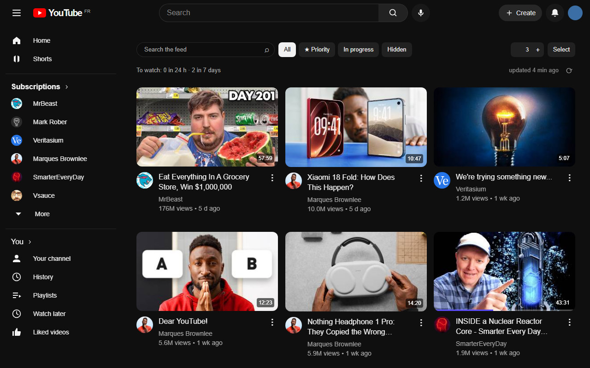
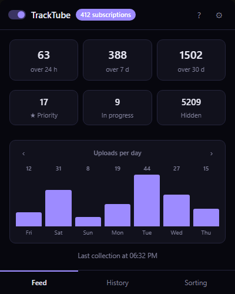
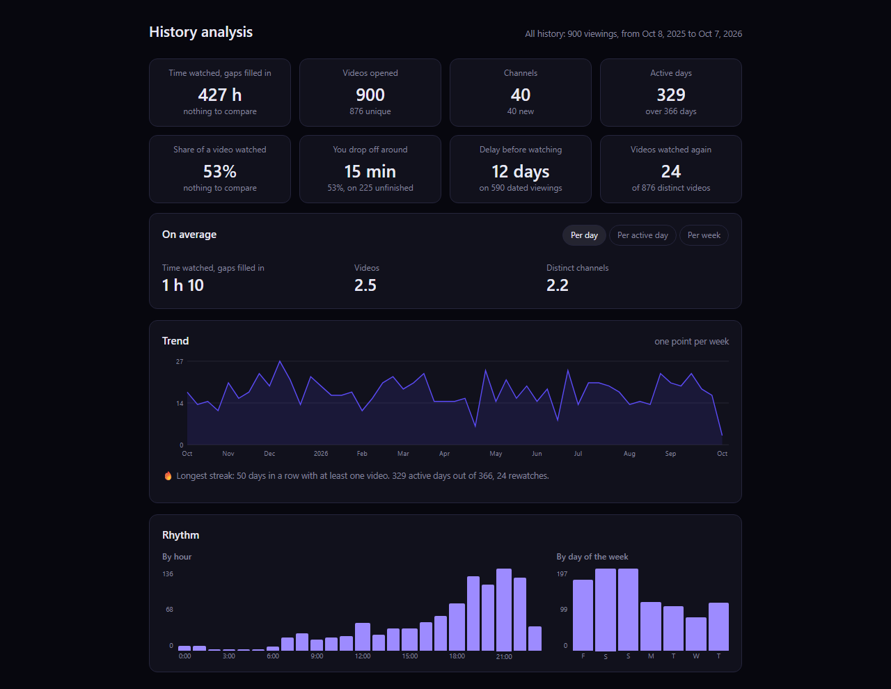
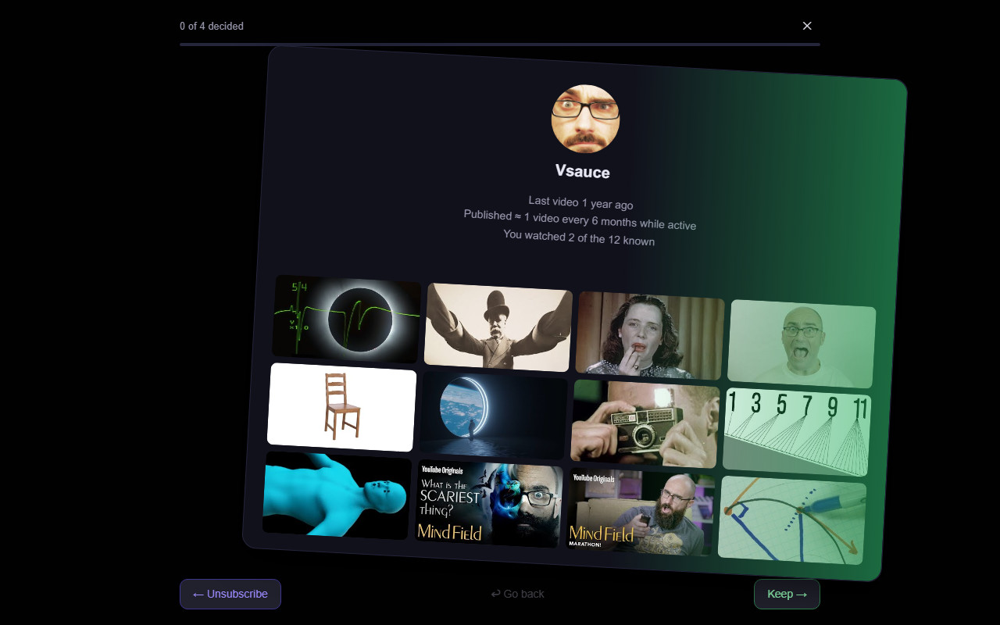

# TrackTube

**English** · [Français](README.fr.md)

**Your YouTube subscriptions, in order, without Shorts.**

TrackTube replaces YouTube's Subscriptions page with the full chronological list
of what the channels you follow have published. No recommendations, no Shorts,
and no video missing from a channel you are subscribed to. Everything stays in
your browser.



---

## Why

YouTube's Subscriptions page does show the most recent videos, and it shows them
in the right order. There is nothing strange about the order. The problem is
what sits above it.

The two sections that open the page, and that take the whole screen on the way
in, are a carousel of what YouTube judges most relevant and a carousel of
Shorts. Both are recommendations. The chronological list of the channels you
actually subscribed to begins under them, once you have scrolled past.

And that list is not always complete. A video from a channel you follow
sometimes never appears at all, and sometimes appears days late.

The direction of travel is the rest of the answer. At Made on YouTube in
September 2026, YouTube announced
[Custom Feeds](https://techcrunch.com/2026/09/23/youtube-will-let-you-build-your-own-algorithm-with-ai/):
you describe in your own words the videos you would like recommended, Gemini
builds the feed, and it gets a tab of its own next to Home. Nothing comparable
was announced for the subscription list.

That list used to be the whole point. You subscribed to the people you wanted to
support, and refreshing the page each day told you which of them had posted
something new. That is what a subscription was for, and it is what is quietly
going away.

TrackTube rebuilds the list from each channel's own public feed, one channel at
a time, and shows it in place of YouTube's. Nothing is filtered unless you asked
for it.

---

## What you get

### A feed that empties

YouTube has a hide of its own. What is wrong with it is not that it is missing,
it is that it is impractical: the tile turns grey and stays exactly where it
was, so hiding twenty videos in a row means aiming at a page that never changes
shape. Here the card leaves the grid as you click, which is what makes hiding in
a chain possible, and a selection mode does it by the batch.

The other half of the problem is not visual. A hidden video is still fetched and
drawn; on a page where nearly everything is hidden and ten videos are kept,
which is what a month looks like once you use the feed as a list of things to
watch, every month makes the page slower. Here hiding is filtered inside the
database index itself: a hidden video is never read, never deserialised, never
rendered. The cost of hiding is constant, and the feed opens as fast with forty
thousand videos hidden as with ten.

That is the use TrackTube is built around. The feed is a list of videos to
watch, that you empty: the moment you know you will not watch something, or you
have already seen it, it goes.

**Stars** are for the other direction. Out of a batch of twenty new videos,
star the two you really mean to watch so they are not lost among the rest, and
they also get a view of their own.

**In progress** tells you which videos you have already started and lets you
pick one up where you left it, from its own view. And if you want the list to
empty itself, you can turn on hiding a video automatically once you have
watched it, with the share of the video that counts as watched being yours to
set.

### A popup that tells you where things stand



One switch turns the takeover of the Subscriptions page off and back on, so
YouTube's own page comes back untouched whenever you want it.

Under it, the figures worth a glance: what arrived in the last day, week and
month, what is starred, what is in progress, how much is hidden, and when the
last collection ran. Then the two doors to the rest of the extension, which are
the next two sections here: the analysis of what you watch, and the card by
card review of your subscriptions.

### An analysis of what you actually watch



Time watched over any range, by channel and by day. The channels you never miss,
and how long your run on each of them is. The delay between a publication and
the moment you opened it. Where you stop watching. What you go back to and how
often. The subjects that keep coming back in the titles, and a broader
classification by topic. The hour of the day and the day of the week you watch
at. Your sittings, meaning viewings grouped into one stretch, and how long they
run. How often a channel publishes. And a day by day journal that shows one
day's rows exactly as they are stored, which is the first place to look when a
figure elsewhere looks wrong.

It draws on three sources, and always says which. A Google Takeout export
covers the years before you installed anything. YouTube's own history page can
be read for the years an export does not reach. And if you turn tracking on,
the extension measures your viewing itself, **in more detail than YouTube's own
history**: YouTube records that you opened a video, while the extension records
when, for how long, and how far into it you got.

Every figure says what it rests on. A total computed over 590 dated viewings out
of 876 says so on screen; a figure that would only be a guess prints a dash
instead.

Three small games are built on the same data:

- **Recap** turns a year, or any range you pick, into six full screen cards: the
  hours watched, the podium of your channels by number of videos and by time
  spent, your peak hour and your record day, the words that keep coming back in
  the titles, and your longest unbroken run on a single channel. Each card
  exports as an image.
- **Duel** puts two of your channels side by side and asks you to bet which one
  you watched more, before the figures appear. You think you know your own
  viewing; being wrong two times out of three says more than a tidy ranking.
- **Tournament** is a knockout bracket between your channels where no figure is
  shown during the duels, so you vote for the channel you would keep rather than
  for the one you watched most. The two rankings do not coincide, and that gap
  is the whole point.

### A card by card review of your subscriptions



The gesture is the one from the dating apps, and that is deliberate: one channel
per card, right to keep, left to unsubscribe, and nothing to read before
deciding. Each card carries that channel's latest videos, how often it
publishes, when it last did, and how much of it you actually watched. Channels
that have stopped publishing come first.

A subscription list grows for years and nobody ever prunes it. Going through it
once in a while is worth the half hour, and it is not only housekeeping: a good
half of the cards are channels you subscribed to eight years ago and had
forgotten about, which turns out to be the nicest part.

Unsubscribing really unsubscribes, so a decision only goes out five cards later
— far enough to change your mind, close enough that nothing waits for the end.

## Install

No build step, no bundler, no dependencies to install. The folder is the
extension.

1. Download or clone this repository.
2. Open `chrome://extensions` and turn on **Developer mode**.
3. Click **Load unpacked** and pick the folder.
4. The welcome page opens. Import your subscriptions from it, in a tab where you
   are already signed in to YouTube.

Chrome 111 or newer, Manifest V3. It also runs on Chromium based browsers such
as Edge, Brave and Opera GX.

**Keep the folder where it is.** For an unpacked extension Chrome derives the
extension id from the folder's absolute path, and the database is filed under
that id. Renaming or moving the folder gives you a different id and an empty
database. Export a backup from the popup before you move anything.

## Your data

Nothing leaves your browser. There is no server, no account, no telemetry, and
no analytics of any kind.

- Your subscriptions, the videos collected, what you hid, what you starred and
  what you watched live in this browser's IndexedDB.
- The extension asks YouTube for the public feeds it needs, and uses the YouTube
  session already open in your tab for the things that require it: reading your
  subscription list, and unsubscribing when you ask it to.
- It never asks for a password or an API key, and holds no credentials.
- The backup is a file you keep.

Permissions requested: `storage`, `unlimitedStorage`, `alarms`, and access to
`https://www.youtube.com/*`. Nothing else. See the
[privacy notice](privacy.html), also reachable from the popup's help panel.

Watch tracking is **off until you turn it on**. Turning it off later does not
erase what was already recorded; the history page has a button for that.

One YouTube account per browser profile. The database attaches itself to the
first account it sees and refuses writes from another, so that two accounts
cannot end up mixed in the same indexes. Use a separate browser profile for a
second account.

## What it does not promise

- **A Short can briefly appear.** Shorts are excluded using YouTube's own lists
  and the player's metadata, and a confirmed exclusion is permanent. But a video
  published minutes ago may not be classified yet, and a failed request excludes
  nothing rather than guessing. Nothing is ever classified from its duration.
- **Automatic collection is shallow.** It reads each channel's recent feed on a
  schedule. The **Refresh** button goes further, walking the Videos and Live
  tabs of every active channel over the last seven days, and reports partial
  coverage when something stopped it.
- **The reverse diagnostic is a comparison, not a certificate.** It tells you
  what YouTube's own page showed that the database does not hold. It cannot
  prove that either side is complete.
- **Hover previews stop at about a minute.** That is YouTube's limit, not ours,
  and it is a duration rather than a size, so no lighter format gets around it.
  The scrub bar shades the part it cannot reach from the first frame.

The [known limits](docs/LIMITES.md) go into detail.

## Development

Plain ES modules loaded by the browser. No build, no bundler, no TypeScript, no
`node_modules`. Read [CONTRIBUTING.md](CONTRIBUTING.md) first, and
[CLAUDE.md](CLAUDE.md) for why the code is shaped the way it is — it records the
decisions that were settled after a bug, which is the part you cannot get from
reading the files.

Always read and write source files as explicit UTF-8.

### Running the checks

The suites are HTML pages you open in a browser. Serve the folder:

```bash
python tools/serve-ranges.py 8731
```

Then open `test/index.html` for the regression suite, `test/modules.html` to
check that every module still imports, and `test/coverage.html` for the
collection paths. **Use a different port per page**: the benches share an
IndexedDB with everything else served from the same origin, and `?cb=N` does not
bust the ES module cache.

If you have Node and Playwright, the same benches run headlessly:

```bash
node tools/test.mjs
```

Set `TRACKTUBE_PLAYWRIGHT_PATH` and `TRACKTUBE_BROWSER_PATH` if they are
supplied from outside the project. `node tools/diagnose-videos.mjs VIDEO_ID`
inspects a video's public metadata without cookies.

`python tools/shoot.py` rebuilds the screenshots in this README, by driving a
headless Chrome over the benches. It needs the network the first time: the feed
and sorting shots use real videos read from public YouTube feeds, and it caches
the channel avatars locally so a capture does not race them.

Build a distribution candidate with `python tools/package.py`. The archive holds
runtime files only.

## Licence

[MIT](LICENSE) © Oihan Barreneche
